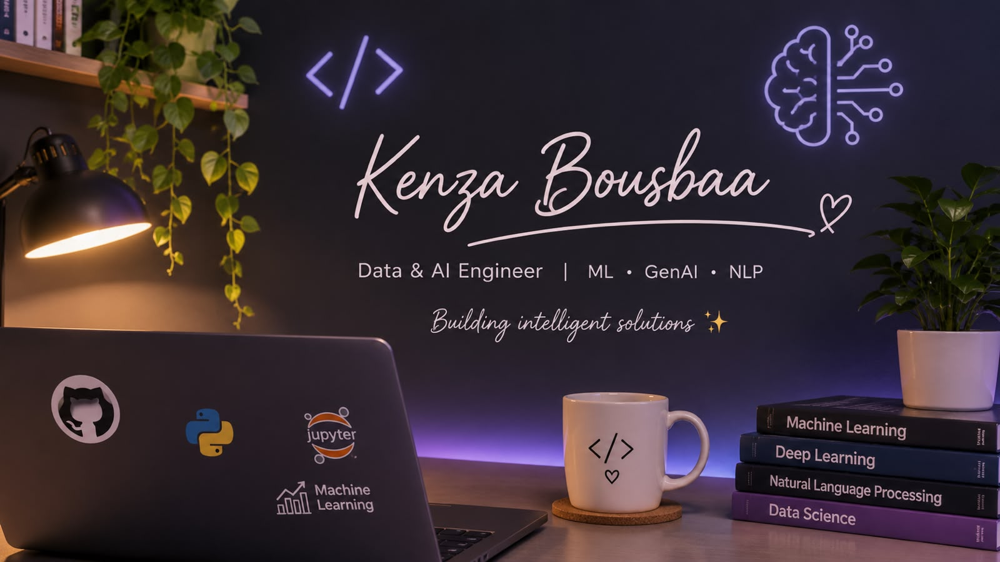

 

 

&nbsp;

---

## 💫 About Me

I am a Master's student in **Advanced Machine Learning and Multimedia Intelligence** at FSDM USMBA, with a solid foundation in Computer Science and Mathematics. I specialize in building intelligent AI applications, RAG architectures, and data-driven solutions that bridge theoretical models with real-world impact.

✨ **My vision:** Transform complex data and cutting-edge AI research into practical, scalable, and intelligent solutions.

---

## 💼 Professional Experience

**Augmented Reality & Software Engineering Intern | ONCF** *(Apr 2025 - Jun 2025)*

> Designed and developed a multilingual augmented reality mobile assistant (Unity, C#, AR Foundation) to optimize passenger navigation and help travelers locate services inside railway stations.

---

## 🧠 Domains of Interest

* 🤖 **Generative AI & Large Language Models (LLMs)**
* 🔍 **Retrieval-Augmented Generation (RAG) & Semantic Search**
* 💬 **Natural Language Processing (NLP) & Transformers**
* 📊 **Machine Learning & Deep Learning**
* ⚙️ **MLOps & Data Engineering**

---

## 🚀 Featured Projects

**Document Intelligence — RAG Assistant** *(GenAI · NLP)*
> Designed an intelligent document question-answering system featuring PDF ingestion, local embeddings, semantic search with FAISS, and LLM-based generation.  
> **Tech Stack:** `Python` · `FastAPI` · `FAISS` · `Ollama` · `Next.js`

**Phishing Website Detection** *(Machine Learning · Cybersecurity)*
> Built and benchmarked five ML classification models to detect malicious websites, achieving **98.55% accuracy** using Random Forest.  
> **Tech Stack:** `Python` · `Scikit-learn` · `Pandas` · `NumPy`

**Face Recognition — PCA vs LDA** *(Computer Vision · Biometrics)*
> Conducted a comparative study of Eigenfaces and Fisherfaces applying dimensionality reduction and classification techniques on the ORL dataset.  
> **Tech Stack:** `Python` · `PCA` · `LDA` · `KNN` · `OpenCV`

**ONCF — Augmented Reality Assistant** *(AR · Mobile)*
> Developed a multilingual augmented reality navigation app for railway stations, guiding passengers seamlessly to station services.  
> **Tech Stack:** `Unity` · `C#` · `AR Foundation`

---

## 🛠️ Tech Stack & Tools

<table align="center">
  <thead>
    <tr>
      <th width="24%" align="center">Domain</th>
      <th width="76%" align="left">Technologies & Skills</th>
    </tr>
  </thead>
  <tbody>
    <tr>
      <td align="center"><b>🤖 AI & Data Science</b></td>
      <td>
        
        
        
        
        
        
        
        
        
        
        
      </td>
    </tr>
    <tr>
      <td align="center"><b>🧠 Frameworks & AI Libs</b></td>
      <td>
        
        
        
        
        
        
        
        
        
        
        
        
        
        
      </td>
    </tr>
    <tr>
      <td align="center"><b>📊 Data & Databases</b></td>
      <td>
        
        
        
        
        
        
        
        
        
        
        
        
        
      </td>
    </tr>
    <tr>
      <td align="center"><b>💻 Programming & Web</b></td>
      <td>
        
        
        
        
        
        
        
        
        
        
        
      </td>
    </tr>
    <tr>
      <td align="center"><b>☁️ Cloud, MLOps & DevOps</b></td>
      <td>
        
        
        
        
        
        
        
        
      </td>
    </tr>
    <tr>
      <td align="center"><b>🔐 Cybersecurity & Biometrics</b></td>
      <td>
        
        
        
        
        
        
        
        
      </td>
    </tr>
    <tr>
      <td align="center"><b>🖥️ Systems & Productivity</b></td>
      <td>
        
        
        
        
        
        
        
      </td>
    </tr>
  </tbody>
</table>

## 📊 GitHub Statistics

&nbsp;

---

*✨ Learning, Building & Exploring AI — Turning ideas into intelligent solutions.*

